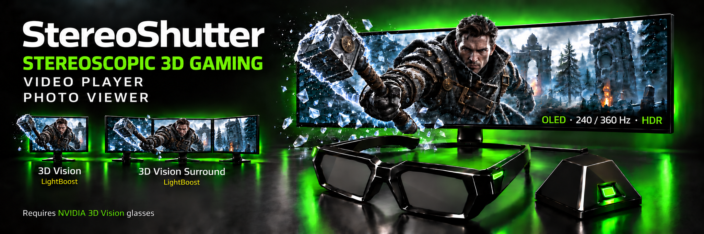
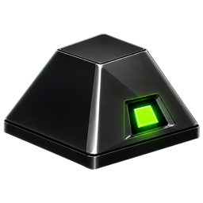
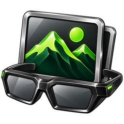

<h1>StereoShutter — 3D gaming, video and photos</h1>

**Geometric 3D games, 3D films, Blu-ray 3D and 3D photos. NVIDIA 3D Vision and supported Samsung TV glasses (experimental), OLED with HDR, LightBoost and NVIDIA Surround.**

### [⬇️ Download StereoShutter Manager 0.1.125](https://github.com/murdavs/StereoShutter/releases/latest/download/StereoShutterManager.zip)

**Recommended:** find your games, install compatible 3D fixes and configure your display from one free application.

[⬇️ Standalone StereoShutter 0.18.111.209](https://github.com/murdavs/StereoShutter/releases/latest/download/StereoShutter.zip) · [Release details](https://github.com/murdavs/StereoShutter/releases/latest) · [What’s new](WHATS_NEW.md) · [Changelog](CHANGELOG.md)

[🌐 Website](https://www.stereoshutter.com) · <a href="https://discord.gg/J6dgWXhAPy"> Discord community</a> · [▶ YouTube](https://www.youtube.com/@stereoshutter) · <a href="https://ko-fi.com/stereoshutter"> Support on Ko-fi</a>

Discord is optional: both applications download directly from GitHub.
This release contains **two independent ZIPs**. Choose Manager for the integrated workflow,
or standalone StereoShutter for manual geo-11 integration, Player and Photos.

Manager includes the reviewed Public **StereoShutter RC20 (0.18.111.220)** and updated manuals.
The standalone ZIP remains **0.18.111.209**, including Player and Photos.
[Manual ES](https://github.com/murdavs/StereoShutter/releases/latest/download/StereoShutter_Manual_ES.pdf) · [Manual EN](https://github.com/murdavs/StereoShutter/releases/latest/download/StereoShutter_Manual_EN.pdf)

[🧩 Get started](#get-started-with-manager) · [Applications](#what-each-application-does) · [🕶️ Your display](#your-display-and-glasses) · [🎮 Games](#games-and-fixes) · [☀️ HDR, films and photos](#hdr-films-and-photos) · [📖 Manuals](#manuals-and-help)

**Detailed guides:** [Tools](docs/STEREOSHUTTER_GUIDE.md#the-tools) · [Display modes](docs/STEREOSHUTTER_GUIDE.md#display-modes) · [Stability](docs/STEREOSHUTTER_GUIDE.md#game-pacing-and-automatic-stability) · [Samsung glasses](docs/STEREOSHUTTER_GUIDE.md#samsung-ssg-5100gb-glasses) · [Multiplayer safety](docs/STEREOSHUTTER_GUIDE.md#multiplayer-and-anti-cheat) · [Reporting a problem](docs/STEREOSHUTTER_GUIDE.md#reporting-a-problem) · [FAQ](docs/STEREOSHUTTER_GUIDE.md#faq) · [Credits](docs/STEREOSHUTTER_GUIDE.md#acknowledgements)

## What each application does

| Product | What it does |
|---|---|
| **StereoShutter Manager** | Finds games, installs and updates compatible fixes, manages backups, configures supported outputs and glasses, and opens Player and Photos. The Manager is free. |
| **StereoShutter Engine** | Our geometric 3D engine for supported DirectX 9 and DirectX 12 games. It comes inside each game-specific fix. |
|  **StereoShutter** | Displays the left and right views and synchronizes supported shutter glasses. It works with current NVIDIA graphics drivers without the discontinued 3D Vision graphics driver. |
|   **Player and Photos** | Play stereoscopic video and view stereoscopic photos through supported glasses. Included in the standalone ZIP and available through Manager. |

A game needs a compatible fix that supplies its stereoscopic views.
StereoShutter does not turn arbitrary 2D games into geometric 3D.
Fixes download separately; neither application ZIP contains your games or a collection of fixes.

## Get started with Manager

1. **Download and extract** `StereoShutterManager.zip` to a writable folder.
   Run `StereoShutterManager.exe` on Windows 10 or 11, 64-bit.
2. **Find your game.** Use the detected library, **Add game** for a missing executable,
   or **Search games** to filter your collection.
3. **Read the fix’s instructions.** Check the game version, graphics API and prerequisites.
   Close the game, then install its compatible fix from the details page.
4. **Choose your display output.** For a geo-11 fix, select StereoShutter when you want
   its supported shutter-glasses output. Engine fixes offer their own supported outputs.
5. **Calibrate shutter glasses.** Open **Glasses**, select the hardware and monitor,
   run the test and save before playing. SBS TVs and Leia SR use different setup routes.
6. **Play.** Return to the game’s page and launch it. Follow its instructions for depth,
   convergence and graphics settings.

Manager downloads required components when requested. Keep its folder together;
do not mix files from different application versions.

**Free features need no subscription.** Public fixes, general glasses configuration, Player and Photos
can be used without signing in. An account is used for eligible early-access content and member features.

[Manager 0.1.125 notes](MANAGER_RELEASE_NOTES.md) · [Detailed Manager workflow](docs/STEREOSHUTTER_GUIDE.md#stereoshutter-manager)

### Your library, across stores

Manager detects installed games from **Steam, Epic Games, GOG, Ubisoft Connect, EA App,
Xbox PC, Battle.net, HoYoPlay, PURPLE and Gaijin** using local installation records.
You can also select a game executable manually.

Detection does not guarantee that a game has a compatible 3D fix.
Xbox PC detection covers supported accessible installations, not cloud games or every Microsoft Store package.

## Your display and glasses

Choose the output first: shutter glasses, a 3D TV and a glasses-free display have different requirements.

| Setup | What you need |
|---|---|
| **NVIDIA 3D Vision on OLED** | 3D Vision 1 or 2 glasses, the NVIDIA USB emitter with its official driver, and a compatible OLED monitor. 240 or 360 Hz are the main setup examples. |
| **Certified 3D Vision monitor** | NVIDIA glasses and emitter, using the monitor’s supported timings. LightBoost and NVIDIA Surround have their own preparation. These displays do not need the OLED route’s 240 Hz. |
| **Samsung TV glasses (experimental)** | **SSG-5100GB**, a **TP-Link UB500** with its official TP-Link driver, and OLED at **240 or 360 Hz**. No NVIDIA emitter. Other glasses and adapters are not covered by this release. |
| **3D TV or projector** | A compatible Engine fix with SBS or Top-Bottom. Enable the display’s matching 3D mode and use its own glasses. No NVIDIA emitter or 240 Hz requirement for this route. |
| **Leia SR** | A supported display, its manufacturer software and a compatible Engine fix. Follow that fix’s panel-resolution and output instructions. |
| **VR and other displays** | Katanga, SBS, anaglyph, row-interleaved or checkerboard where supported by the fix and receiving application. Katanga does not turn a game into native head-tracked VR. |

The shutter-glasses route requires a supported NVIDIA GPU and its graphics driver.
The game and fix determine the GPU features needed for other outputs.

### Refresh rate, brightness and calibration

- **240 Hz:** 60 stereo cycles per second; each eye gets an image and a black refresh.
- **360 Hz at 60 cycles:** each eye’s image is held for two refreshes, then black,
  giving more room for brightness when the glasses are calibrated.
- **360 Hz at 90 cycles:** available with NVIDIA 3D Vision for smoother motion.
  Samsung’s offered 240 and 360 Hz modes both use 60 cycles per second.
- Additional NVIDIA modes, including 300 Hz and 371–555 Hz, are listed in the
  [display-mode guide](docs/STEREOSHUTTER_GUIDE.md#display-modes).
  Modes listed as untested remain untested on physical monitors.

A stereo cycle contains a left and a right view. Output capacity is not a promise
of game FPS: performance depends on the game, GPU and graphics settings.
Save calibration for the monitor and mode you use. With the test bars, the other eye’s bar
should stay faint, not white; do not try to make it disappear completely.

[Monitor requirements](docs/STEREOSHUTTER_GUIDE.md#monitors) · [Samsung setup](docs/STEREOSHUTTER_GUIDE.md#samsung-ssg-5100gb-glasses) · [LightBoost and Surround](docs/STEREOSHUTTER_GUIDE.md#lightboost-in-nvidia-surround)

## Games and fixes

### Our DirectX 12 fixes

**StereoShutter Engine** renders a separate geometric perspective for each eye.
We develop and test its fixes game by game, focusing on modern AAA titles,
including their effects, menus and interface depth.

Ray tracing, DLSS Super Resolution and DLSS Frame Generation work in supported games
and fixes. Enable the game’s own Frame Generation where available; HAGS must be enabled for it.
Not every title or graphics option has the same support.

- **The Witcher 3: Wild Hunt (DirectX 12)** is our first Engine title.
  Check its available version and instructions in Manager.
- **Marvel’s Guardians of the Galaxy** is the next title in development.
- **Star Wars Outlaws** is also in development.

Game-fix releases and updates are independent of the application versions.
A preview video does not mean a fix is available to download.

### Community geo-11 fixes

Manager also installs compatible **DirectX 11 geo-11 fixes published on [HelixMod](https://helixmod.blogspot.com/search/label/geo-11)**.
These are the work of their respective authors. Instructions, credits and donation links are preserved.

**We do not sell HelixMod fixes.** They are not part of our subscription early access.
For manual installation, install the geo-11 fix first, then connect StereoShutter with
`StereoShutter_geo-11_Setup.exe`. Both 64-bit and supported 32-bit geo-11 games are covered by this release.

[Manual installation and supported fixes](docs/STEREOSHUTTER_GUIDE.md#games)

## HDR, films and photos

StereoShutter recognizes compatible native HDR10 and scRGB game images.
On a supported HDR display and output, it also offers SDR-to-HDR output with adjustable brightness,
contrast and colour. Use SDR for legacy LightBoost and NVIDIA Surround setups.

- **Player 1.0.4:** SBS and Top-Bottom videos, unencrypted Blu-ray 3D and compatible browser-video capture.
  Requires **VLC 3, 64-bit**, installed separately; VLC 4 is not supported.
- **Photos 1.0.3:** MPO camera photos, JPS, SBS and Top-Bottom pictures, slideshow, zoom and depth controls.
- **Game photos:** `Ctrl+Alt+P` saves stereoscopic screenshots in SBS, HDR or red-cyan anaglyph formats.
  These are photographs, not video recording.

[HDR guide](docs/STEREOSHUTTER_GUIDE.md#hdr-input-and-output) · [Player](docs/STEREOSHUTTER_GUIDE.md#stereoshutter-player) · [Photos](docs/STEREOSHUTTER_GUIDE.md#stereoshutter-photos)

## Free software, independent development

**Manager, StereoShutter, Player and Photos are free.** Our Engine fixes become free
for everyone after a few days of Beta and Priority early access.
You always need your own compatible copy of the game.

Community support funds development, tools, hardware and the time needed to test complete games.
Beta and Priority members can vote on upcoming Engine fixes; membership does not guarantee
that a particular game will be released on a particular date.

[Support on Ko-fi](https://ko-fi.com/stereoshutter) · [Follow development on Discord](https://discord.gg/J6dgWXhAPy)

## Manual installation and updates

Choose the standalone package to configure StereoShutter manually
or use Player and Photos independently of Manager.

When updating a game installation, close the game and update **StereoShutter.exe and its host DLLs together**
from the same download. This release uses `StereoShutter_host.dll` and `StereoShutter_host32.dll` 0.18.32;
the host DLLs from 0.18.83 are not compatible. Preserve the game’s `StereoShutter.ini` and your calibration.

HAGS is supported in StereoShutter 0.18.111.209. With HAGS on, accept the administrator prompt
for StereoShutter’s scheduling helper. Follow the guide for NVIDIA settings and glasses setup.

[Full standalone installation guide](docs/STEREOSHUTTER_GUIDE.md#quick-start) · [All changes](CHANGELOG.md)

## Manuals and help

| Guide | English | Español |
|---|---|---|
| StereoShutter | [PDF](docs/StereoShutter_Manual_EN.pdf) | [PDF](docs/StereoShutter_Manual_ES.pdf) |
| Player | [PDF](docs/StereoShutter_Player_Manual_EN.pdf) | [PDF](docs/StereoShutter_Player_Manual_ES.pdf) |
| Photos | [PDF](docs/StereoShutter_Photos_Manual_EN.pdf) | [PDF](docs/StereoShutter_Photos_Manual_ES.pdf) |
| Manager | `docs/USER_GUIDE.md` in its ZIP | Setup and account help are available in the application |

The [detailed technical guide](docs/STEREOSHUTTER_GUIDE.md) retains full setup steps,
keyboard shortcuts, monitor modes, troubleshooting and standalone tools.

For support, include the game, fix version, GPU, monitor and output mode.
Use **StereoShutter_Feedback** for diagnostics and review its package before sharing.
Send full logs privately; do not post account or device information in public channels.

[Discord](https://discord.gg/J6dgWXhAPy) · [info@stereoshutter.com](mailto:info@stereoshutter.com)

**Multiplayer and anti-cheat:** injected fixes can be blocked or lead to account sanctions.
Use only modes permitted by the game and read [the safety guidance](docs/STEREOSHUTTER_GUIDE.md#multiplayer-and-anti-cheat).

Applications are unsigned. Use this repository’s Releases and check the published SHA-256.
Do not disable Windows or antivirus protections to bypass a warning.

© 2026 murdavs. Freeware, not open source. Each package includes its licence and third-party notices.
Game fixes retain their authors’ terms. Independent of NVIDIA, Samsung and game publishers.

