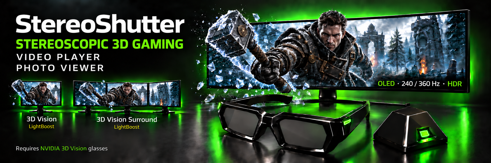
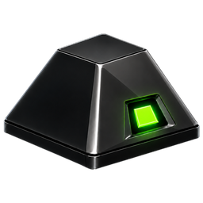
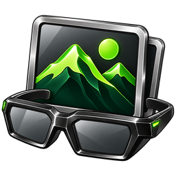
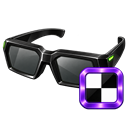
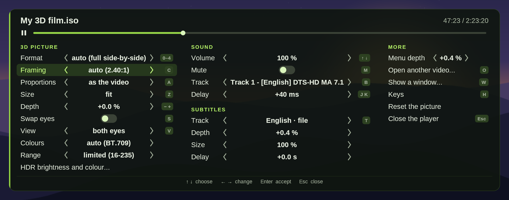
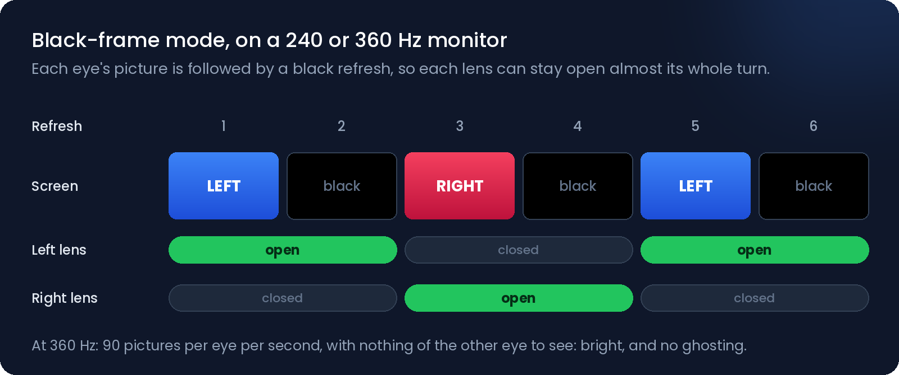
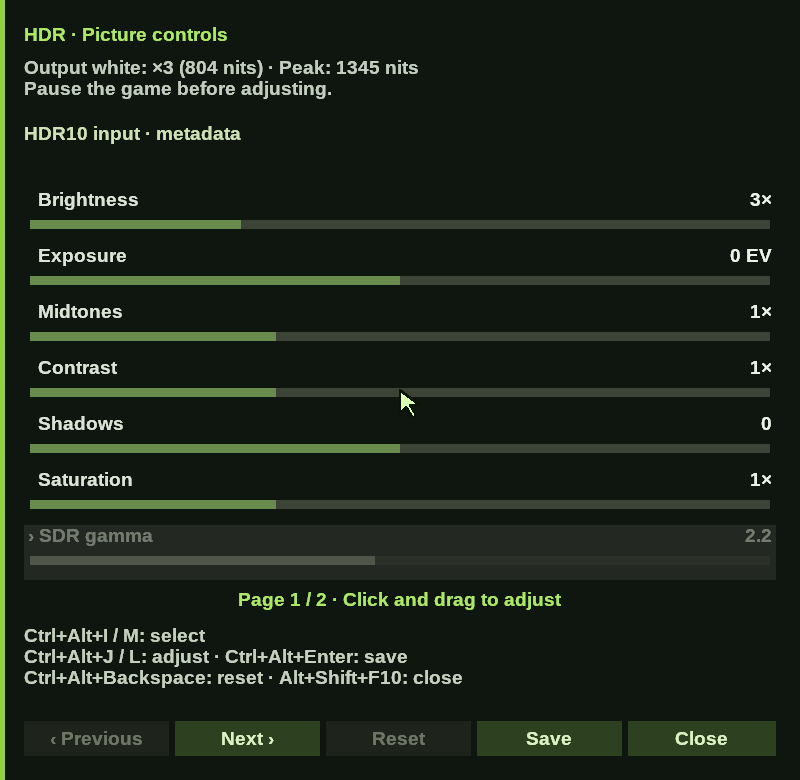
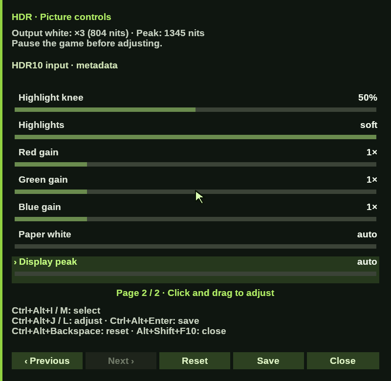

<h1>StereoShutter — 3D gaming, video and photos</h1>

**3D games, 3D films, Blu-ray 3D and 3D photos with your NVIDIA 3D Vision glasses. OLED at 240 / 360 Hz with optional HDR output; 3D Vision monitors with LightBoost, including NVIDIA Surround.**

### [⬇️ Download StereoShutter 0.18.83](../../releases/latest)

[Highlights](#highlights) · [🎮 Games / HelixMod](#games-start-with-helixmod) · [⚠️ Multiplayer safety](#multiplayer-and-anti-cheat) · [Quick start](#quick-start) · [Tools](#the-tools) · [🎬 Player](#stereoshutter-player) · [📷 Photos](#stereoshutter-photos) · [Monitors](#monitors) · [Display modes](#display-modes) · [Stability](#game-pacing-and-automatic-stability) · [HDR](#hdr-input-and-output) · [Reporting a problem](#reporting-a-problem) · [FAQ](#faq) · [Credits](#acknowledgements) · [📖 Manuals](#documentation-and-licence)

---

**Bring your legacy NVIDIA 3D Vision glasses back to life.** StereoShutter shows stereoscopic images and synchronizes the shutter glasses with the monitor. It uses NVIDIA's emitter USB driver and works alongside the installed NVIDIA graphics driver, without the discontinued 3D Vision graphics driver. It is an independent application that complements existing 3D communities and game fixes.

For games, a 3D fix or layer supplies the left and right views. **StereoShutter Player 1.0.2** brings 3D films, unencrypted Blu-ray 3D and 3D videos playing in a browser to the same glasses, and **StereoShutter Photos 1.0.2** shows 3D photos, both with **HDR output to make them brighter through the glasses**. StereoShutter handles the presentation, the timing and the glasses' values. It does not turn 2D pictures into 3D.

> 🎮 **For games, start with HelixMod.** First find, download and install your game's **geo-11 fix** from [HelixMod](https://helixmod.blogspot.com/search/label/geo-11), following that game's instructions. **Then** add StereoShutter to the same game folder and run **StereoShutter_geo-11_Setup**. StereoShutter does not include game fixes or make arbitrary games 3D. [Game setup](#games-start-with-helixmod) · Player and Photos do not need game fixes.

Each program comes with an **illustrated manual in English and Spanish** (PDF).

> ⚠️ **Single-player recommended — multiplayer / anti-cheat risk**
>
> 3D layers and fixes get into the game (DLL files and hooks). Anti-cheat systems may block them or impose account sanctions, including permanent bans, even when they are used only for 3D. **This setup is not recommended for online multiplayer or for games protected by anti-cheat.** Read the [safety guidance](#multiplayer-and-anti-cheat) before installing anything in a game.

## Highlights

<table>
<tr>
<td width="50%" valign="top">

### ☀️ Stereoscopic gaming with native HDR

**240 / 360 Hz, with a black refresh between the eyes.**

Play HDR games in stereoscopic 3D on a high-refresh OLED. For SDR games, HDR output works as a separate brightness boost through the glasses: **3× Windows' SDR white** by default, adjustable with **Ctrl+Alt+Page Up / Page Down**, never above the monitor's peak.

HDR10 and scRGB game pictures are recognized; an HDR panel adjusts brightness, contrast, colour and highlights with the mouse, in both eyes.

</td>
<td width="50%" valign="top">

### 💡 3D Vision + LightBoost

**One NVIDIA-certified 3D Vision monitor, or three in NVIDIA Surround.**

Recognized modes use NVIDIA's glasses and display timing table, with LightBoost switched on for the session and restored at the end.

For an **NVIDIA Surround** grid, dedicated setup and undo tools prepare the monitors' LightBoost timings. On-screen texts stay on the middle monitor.

</td>
</tr>
<tr>
<td width="50%" valign="top">

### 🎬 3D video player

**3D films, Blu-ray 3D and browser video, brighter through the glasses.**

Half or full side-by-side and top/bottom videos, unencrypted Blu-ray 3D at **1920 × 1080 per eye**, or a browser's 3D video through window capture. A 3D menu with the mouse, subtitles at their own depth, **seven languages**.

[More](#stereoshutter-player) · [English PDF](docs/StereoShutter_Player_Manual_EN.pdf) · [PDF en español](docs/StereoShutter_Player_Manual_ES.pdf)

</td>
<td width="50%" valign="top">

### 📷 3D photo viewer

**Photos of 3D cameras, JPS and side-by-side pictures.**

MPO files of 3D cameras, JPS and PNS, side-by-side and top/bottom pictures and 2D photos: a whole folder with the arrow keys or as a slideshow, full screen or in a window, with zoom and depth.

[More](#stereoshutter-photos) · [English PDF](docs/StereoShutter_Photos_Manual_EN.pdf) · [PDF en español](docs/StereoShutter_Photos_Manual_ES.pdf)

</td>
</tr>
<tr>
<td width="50%" valign="top">

### 🎯 Automatic stability

**The supplied settings adapt to the game by themselves.**

The output margin grows when the graphics card is late, and is remembered for that game. StereoShutter's GPU priority rises only while its images are about to be late. For a game that fills the graphics card, StereoShutter keeps a part of it for its images. The game's frames are paced to the glasses' cycles.

[Pacing and automatic stability](#game-pacing-and-automatic-stability)

</td>
<td width="50%" valign="top">

### 📖 Manuals and help

**Illustrated PDF manuals, in English and Spanish.**

Step by step: the three NVIDIA and Windows settings, setting up the glasses, games with geo-11, HDR, the messages on the screen and what to do about them.

When something goes wrong, **StereoShutter_Feedback** records one game session into a single file of at most 5 MB, ready to send by e-mail.

[StereoShutter manual (EN)](docs/StereoShutter_Manual_EN.pdf) · [Manual de StereoShutter (ES)](docs/StereoShutter_Manual_ES.pdf)

</td>
</tr>
</table>

- 🎮 **Game integration:** DirectX 11 games through geo-11 and StereoShutter's host DLL, connected by a setup tool with undo; DirectX 12 games through the **SLT12 Output** layer, which has not been publicly released yet and is not part of the download.
- 🎯 **Pacing:** the game's frames in step with the glasses: **60 cycles a second at 360 Hz** (90 for games that keep 90), **60 at 240 Hz**.
- 🧭 **Glasses setup:** a guided assistant, and a quick setup inside a paused game; the values are shared by every game folder.
- ⌨️ **While playing:** turn the 3D off and on, swap the eyes, change the HDR brightness and look, and the settings for each game, in panels with the mouse.
- 🚨 **Safety nets:** messages on the screen that say what to change, and an independent stop watcher that switches the emitter off even if the picture is stuck.

## Games: start with HelixMod

**The game's geo-11 fix comes first.** Find your exact game on [HelixMod's geo-11 pages](https://helixmod.blogspot.com/search/label/geo-11), download its fix and follow its installation instructions, including the required game version, DirectX/API mode and game settings. Check that the fix supports your version of the game before continuing.

The fix supplies the stereoscopic views. StereoShutter displays those views and synchronizes the glasses; **it does not supply the game fix or turn an arbitrary game into 3D**. After installing the fix, copy **the contents of the ZIP's StereoShutter folder** beside the game's executable and the installed fix, run **StereoShutter_geo-11_Setup.exe** there with the game closed, and then launch the game. Follow the [numbered connection steps](#4-connect-a-game) after setting up your glasses.

This public game setup uses **DirectX 11 / geo-11**. The DirectX 12 **SLT12 Output** layer has not been publicly released and is not included. **Player and Photos do not need HelixMod or geo-11 fixes**; they use your video and photo files.

## Multiplayer and anti-cheat

Prefer **single-player games that permit these modifications**. Single-player or offline mode alone does not guarantee that anti-cheat is absent or that a game's rules allow the integration. Compatibility and enforcement depend on the game and its publisher; StereoShutter cannot guarantee that an account is safe from sanctions.

**Turning 3D off or closing StereoShutter does not remove what is installed in the game's folder.** Before returning to protected online play, follow the removal steps for StereoShutter **and** for the game's 3D fix, and restore a clean game installation. Never bypass or disable anti-cheat protections.

Check the publisher's current rules and ask for explicit confirmation if support is unclear. For examples of game-specific restrictions, see [Valve's Trusted Mode guidance](https://help.steampowered.com/en/faqs/view/09A0-4879-4353-EF95) and [VAC information](https://help.steampowered.com/en/faqs/view/571A-97DA-70E9-FF74); these are not a compatibility approval for StereoShutter or for other games.

## Quick start

### 1. Check the requirements

- Windows 10 or 11, 64-bit, an NVIDIA graphics card ([which one](#which-graphics-card)), NVIDIA 3D Vision glasses and their USB emitter. Some 3D Vision monitors have the emitter built in, and its signal comes through the video cable, not through USB. StereoShutter cannot use that emitter: with those monitors, the separate USB emitter is needed.
- NVIDIA's emitter USB driver installed: Device Manager shows **NVIDIA Stereoscopic 3D USB controller**. The driver is available from [NVIDIA](https://www.nvidia.com/en-us/drivers/nv3dvisionusb/390_41/nv3dvisionusb-dch-driver/) and is not part of the download.
- A compatible PC monitor that meets the [panel-response and strobing requirements](#monitors), with a supported [display mode](#display-modes) selected in Windows before starting.
- For games, install the game's **geo-11 fix from [HelixMod](https://helixmod.blogspot.com/search/label/geo-11) first**, following its instructions and required game version and DirectX/API mode. See [Games: start with HelixMod](#games-start-with-helixmod). For films and photos, see the [Player](#stereoshutter-player) and [Photos](#stereoshutter-photos); no game fix is needed.

Only one program should drive the emitter. Close other glasses software and VR sessions first.

### 2. NVIDIA and Windows settings

**Only three settings.** StereoShutter checks them at the start and says on screen if one is missing.

1. **Hardware-accelerated GPU scheduling off, then restart Windows.** Settings → System → Display → Graphics settings. With it on, the glasses do not start.
2. **Global Low Latency Mode: On or Off, never Ultra.** NVIDIA Control Panel → Manage 3D settings → Global Settings. Ultra in a single game's profile is fine.
3. **G-SYNC off on the glasses' monitor** (Fixed Refresh). 3D Vision monitors have no G-SYNC.

At every start StereoShutter keeps **its own NVIDIA profile, for StereoShutter.exe only** (no low latency for it, no FPS limit, its own vertical sync, maximum performance). **Global settings and game profiles stay as they are.** `[Output] nvidia_profile = no` turns this off.

In the game: vertical sync off, and borderless full screen or windowed. While playing, keep the game in front and close what keeps drawing: browsers, videos, chat programs, the game's launcher.

### 3. Download and set up the glasses

Download **StereoShutter-0.18.83.zip** from [Releases](../../releases/latest) and compare its SHA-256 with the one published there. The current programs are unsigned, so Windows may warn or block them; read the [digital-signature FAQ](#faq) before running them. Extract it to a folder where you can write. It has three folders:

| Folder | What it is |
|---|---|
| **StereoShutter** | StereoShutter for games, its tools, the manual and the user guide |
| **StereoShutter Player** | The 3D video player, with its own copy of StereoShutter |
| **StereoShutter Photos** | The 3D photo viewer, with its own copy of StereoShutter and three sample photos |

Set Windows to the refresh rate you will play at and run **StereoShutter_Setup.exe** in the StereoShutter folder. This adjusts the glasses; **StereoShutter_geo-11_Setup.exe** is the separate tool that connects each game in step 4.

| Step | What you see | What to do |
|---|---|---|
| Ghost | Crosstalk bars | Close one eye; ← / → until the faint bar disappears. Check the other eye. |
| Eyes | A rectangle with depth | It should float in front of the screen. S swaps the eyes, then Enter. |
| Brightness | Crosstalk bars | ↑ opens the lenses longer; ↓ if the faint bar comes back. |
| Save | The values | Enter saves. |

It is done once for each monitor and refresh rate, and works for every game, the player and the viewer. 3D Vision monitors use NVIDIA's values. On an HDR monitor the assistant offers **H** for the HDR output; then run it again with HDR.

### 4. Connect a game

⚠️ Read [Multiplayer and anti-cheat](#multiplayer-and-anti-cheat) first.

**DirectX 11 / geo-11 — follow this order:**

1. **Install the game's fix first.** Find and download its geo-11 fix from [HelixMod](https://helixmod.blogspot.com/search/label/geo-11). Follow the game's instructions, including its required game version, DirectX/API mode and settings. StereoShutter does not install this fix.
2. **Copy the contents, not the enclosing folder.** With the game closed, open the extracted ZIP's **StereoShutter** folder and copy its contents into the folder containing the actual game .exe and the installed HelixMod fix. **StereoShutter.exe and StereoShutter_geo-11_Setup.exe must sit beside the game's executable, not inside an extra StereoShutter subfolder.** Follow the fix's game-specific folder instructions; do not use the launcher's folder. Player and Photos stay separate. If updating an existing installation, back it up and keep that game's StereoShutter.ini: it holds its saved settings.
3. **Connect the installed fix.** Run **StereoShutter_geo-11_Setup.exe** from that same game folder. Read the changes it proposes and press Enter to apply them. This is the game-integration setup, not the glasses assistant.
4. **Launch the game and wait for the window to settle.** Games often change resolution or switch between windowed and fullscreen modes during startup. StereoShutter waits for those changes to finish: **3D activates automatically 5–10 seconds after the game window and resolution become stable**, not 5–10 seconds after launching the game. This delay avoids activating 3D during the startup display transitions.

The setup connects geo-11 with these settings:

~~~ini
; d3dx.ini
[System]
proxy_d3d11 = StereoShutter_host.dll

; d3dxdm.ini
[Device]
direct_mode = katanga_vr
~~~

It also gets the fix ready: `full_screen = 0` and `create_profile = 0` where the fix sets something else (exclusive full screen hides the 3D, and fixes made for 3D Vision write a 3D Vision profile), `[Host] geo11_load_redirect = yes` where geo-11's `load_library_redirect` is on, and, in two known versions of geo-11, a fix for a fault of its d3d11.dll that now and then closes the game when the 3D starts. It keeps a copy of every file it changes, asks for REPLACE before removing another chained DLL, and offers **UNDO** when run again. It does not install the game's 3D fix.

**StereoShutter_Play** starts StereoShutter by hand for an already configured game.

**DirectX 12 / SLT12 Output:** the layer starts StereoShutter by itself, full screen included. **SLT12 Output has not been publicly released yet and is not part of the download.**

### 5. The keys

| Keys | What they do |
|---|---|
| Ctrl+T | Turn the 3D off and on |
| Ctrl+Alt+S | Swap the eyes |
| Ctrl+Alt+K | The keys, then the settings for this game, then the quick setup (pause the game first) |
| Ctrl+Alt+Enter | Save the glasses' values and the HDR settings |
| Ctrl+Alt+Page Up / Page Down | HDR brightness |
| Alt+Shift+F10 | The HDR panel |
| Ctrl+Alt+H | The game's picture read as Auto or HDR10, this session only |
| Ctrl+Alt+F | The FPS counter |
| Ctrl+Alt+G | Lock the glasses again |
| Ctrl+Alt+F12 | Stop StereoShutter and switch the emitter off; the game goes on |

Keys without Alt, such as Ctrl+T, are taken only while the game or StereoShutter is in front, so other programs keep them.

## The tools

Each tool is a small program with its own icon, in the StereoShutter folder.

| Tool | What it does |
|---|---|
|  **StereoShutter_Setup** | The assistant to set up the glasses. |
|  **StereoShutter_Test** | The test pattern for ten minutes, with the setup keys and a report. |
|  **StereoShutter_Play** | Starts StereoShutter by hand for a game. |
|  **StereoShutter_geo-11_Setup** | Connects StereoShutter to geo-11 in a game's folder and gets the fix ready, or undoes it. |
|  **StereoShutter_Undo_LightBoost** | Puts a monitor's previous signal back if LightBoost was left on. |
|  **StereoShutter_LightBoost_Surround_Setup** | Prepares LightBoost on an NVIDIA Surround grid, once. |
|  **StereoShutter_LightBoost_Surround_Undo** | Removes it. |
|  **StereoShutter_Feedback** | Records your next game session to [report a problem](#reporting-a-problem). |

## StereoShutter Player

*The Player's menu, from its manual. "HDR brightness and colour" opens StereoShutter's HDR panel.*

**StereoShutter Player 1.0.2** is a separate video player that shows its pictures through StereoShutter. On an HDR monitor, **StereoShutter's HDR output makes SDR 3D films brighter through the glasses**. It starts StereoShutter by itself and closes it when it closes.

| Source | What it plays |
|---|---|
| Video files | Half or full **side-by-side (SBS)**, half or full **top/bottom (TAB / OU)**, and **2D**. The format comes from the file, its name or its size; the menu chooses another. |
| Blu-ray 3D | **Unencrypted ISO images and BDMV folders**, at **1920 × 1080 per eye**, with pause, seeking and sound tracks. |
| A window | A 3D video playing in a browser or another program, through window capture. Protected video shows black. |

Drag a video, an ISO image or a Blu-ray folder onto **StereoShutter_Player.exe**, or open it and choose. Right-click or **Enter** opens the menu; **Space** pauses; **O** opens another video; **W** shows a window; **Esc** closes. For a browser video, put it **full screen on another monitor**, then choose it with W.

- 🖼️ **Framing:** black bars found and left out, crop, proportions, fit, zoom, fill or stretch.
- 🕶️ **3D:** depth, swap eyes, one eye in both (to check). 2D videos stay 2D.
- 🔊 **Sound:** volume, mute, sound track and delay.
- 💬 **Subtitles:** text and PGS tracks of Matroska files, and SRT, ASS or SSA files beside the film, at their own depth and size.
- 🌍 **Seven languages:** English, Spanish, Italian, French, German, Portuguese and Russian.

**It needs:** Windows 10 or 11, 64-bit, a DirectX 12 graphics card, the glasses set up, and **VLC media player 3, 64-bit**, installed separately for files and Blu-rays ([VideoLAN](https://www.videolan.org/vlc/); VLC is not included, VLC 4 is not supported). Window capture needs Windows 10 version 1903 or later. Its folder in the download includes StereoShutter 0.18.83 with settings for films.

**Not supported:** a film's own HDR (HDR films are shown as normal pictures, which StereoShutter's HDR output then brightens), encrypted Blu-rays, disc menus and disc subtitles, MVC 3D inside MKV files, subtitles of other containers and VobSub.

📖 [Player manual — English PDF](docs/StereoShutter_Player_Manual_EN.pdf) · [Manual del reproductor — PDF en español](docs/StereoShutter_Player_Manual_ES.pdf)

## StereoShutter Photos

**StereoShutter Photos 1.0.2** shows 3D photos through StereoShutter, as the Player shows films, with the same HDR output, menu and pointer in front of the screen.

- 📷 **Formats:** photos of 3D cameras (**MPO**), **JPS** and **PNS** files, side-by-side and top/bottom pictures (named by a 3D tag, or found by comparing their halves) and 2D photos. Keys 1–4 and 0 choose another format.
- 🗂️ **A whole folder:** the arrow keys, Home and End, or a slideshow; the next photo is read ahead.
- 🔍 **Zoom and depth:** the mouse wheel zooms in around the pointer, a large photo is dragged with the mouse, and the depth of the whole photo moves forward or back.
- 🪟 **Full screen or in a window** (F, F11, Alt+Enter or a double click). Full screen is the safe choice for the glasses.
- 🎨 **Colours:** EXIF orientation, and colour profiles (Display P3, Adobe RGB) made sRGB.

Drag a photo or a folder onto **StereoShutter_Photos.exe**. Three sample photos come in its **Samples** folder. Photos are read by Windows itself: HEIC, WebP and AVIF need their Windows image extensions.

📖 [Photos manual — English PDF](docs/StereoShutter_Photos_Manual_EN.pdf) · [Manual de Photos — PDF en español](docs/StereoShutter_Photos_Manual_ES.pdf)

## Monitors

**For the cleanest 3D, choose an OLED at 240 / 360 Hz or an NVIDIA 3D Vision monitor with LightBoost.** Refresh rate alone is not enough: the panel must complete its pixel transitions while the other eye is hidden.

The matrix separates **practical tests** from **expected results**. Cells marked **tested** report an observed result; all other assessments are expectations based on panel response, not confirmation that every model works equally well. For the supported refresh-rate ranges and presentation sequences, see [Display modes](#display-modes).

| Windows refresh rate and display mode | Stereo cycles/s | OLED: <0.1 ms | Fast LCD: ≈1 ms | LCD: 2–4 ms | Slow LCD: >4 ms |
|---|---|---|---|---|---|
| **360 Hz · black refreshes between eyes** | **60** as supplied; **90** optional | ✅ Clean **(tested)** | ⚠️ Mild ghosting | ⚠️ Visible ghosting | ❌ Heavy ghosting |
| **240 Hz · black refreshes between eyes** | **60** | ✅ Clean | ✅ Clean | ⚠️ Visible ghosting | ❌ Heavy ghosting |
| **100–185 Hz · monitor strobing enabled** (e.g. ULMB / ELMB / DyAc) | Half the refresh rate | ✅ Clean **(tested at 180 Hz)** | ✅ Clean | ⚠️ Depends on strobing | ⚠️ Depends on strobing |
| **100–185 Hz · no monitor strobing** | Half the refresh rate | ❌ Heavy ghosting **(tested)** | ❌ Heavy ghosting | ❌ Heavy ghosting | ❌ Heavy ghosting |
| **NVIDIA 3D Vision · LightBoost**, in a recognized mode | Half the refresh rate | — | ✅ Clean **(tested)** | — | — |

**Key:** ✅ Clean or nearly clean 3D. ⚠️ Works with ghosting; its extent depends on the panel and, where noted, the monitor's strobing. ❌ Not recommended because of heavy ghosting. A ❌ result describes picture quality; it does not mean that StereoShutter refuses to start at that refresh rate.

### Why panel response and strobing matter

At **360 Hz**, one black refresh lasts approximately **2.8 ms**; at **240 Hz**, approximately **4.2 ms**. There is one black refresh between the left and right eyes' images, giving the pixels time to complete their transition before the next eye opens. Slow transitions leave some of the previous eye's image visible as ghosting.

The response-time columns refer to **real pixel response**, preferably measured independently. An advertised **“1 ms” grey-to-grey** figure, often obtained with aggressive overdrive, does not establish how quickly the panel completes a transition to full black and back. Those transitions can take longer.

At **100–185 Hz**, StereoShutter presents one refresh per eye without inserting the black refresh used at higher rates. The monitor's **own strobing must be enabled** for the clean results in the strobing row; the no-strobing row shows why even a fast OLED can produce heavy ghosting in that mode. NVIDIA 3D Vision monitors use **LightBoost**, with NVIDIA's timing in recognized modes.

### Display modes

**StereoShutter 0.18.83 chooses the presentation mode from the monitor and the refresh rate selected in Windows. It never changes the refresh rate.** Select the required Windows mode before starting.

| Mode | Windows refresh rate | Presentation | Stereo cycles/s | Practical testing |
|---|---|---|---|---|
| **NVIDIA 3D Vision** | Only **refresh-rate and resolution combinations listed in NVIDIA's timing table**, for example 120 or 144 Hz | One refresh per eye, with **LightBoost** | **Half** the refresh rate: 120 Hz → **60** | **Tested at 120 Hz**, including **NVIDIA Surround** |
| **One refresh per eye** | **99–185 Hz**, including 100, 120, 144, 165 and 180 Hz | The monitor's own strobing, such as **ULMB / ELMB**, separates the eyes; without it, ghosting remains | **Half** the refresh rate: 144 Hz → **72**; 180 Hz → **90** | **Tested at 180 Hz on OLED with its own strobing** |
| **Two refreshes per eye** | **198–370 Hz**, including 200, 240, 280, 300 and 360 Hz | **Image · Black** for each eye | **One quarter** of the refresh rate: 240 Hz → **60**; 360 Hz → **90** | **Tested at 360 Hz on OLED** |
| **Three refreshes per eye — default at 297–370 Hz** | **297–370 Hz** | **Image · Image · Black** for each eye | **One sixth** of the refresh rate: 360 Hz → **60** | **Tested at 360 Hz on OLED** |
| **Unsupported refresh rates** | **Below 99 Hz, 186–197 Hz or above 370 Hz** | The glasses do not start | — | — |

At **297–370 Hz**, three refreshes per eye are the default. To choose two, open **Per-game settings → Glasses cycles**, or set `refreshes_per_eye = 2` in the `[BFI]` section of StereoShutter.ini. The [360 Hz comparison below](#360-hz-60-or-90-cycles) shows both sequences and their trade-off.

**Other refresh rates within the supported ranges work by design, but have not been tested on a real monitor.** The tested entries above identify the practical observations; they are not a test of every rate or monitor in a range.

Timing support does not guarantee clean 3D. Use the [monitor compatibility matrix](#monitors) to assess panel response and strobing. NVIDIA Surround requires the dedicated [LightBoost setup](#lightboost-in-nvidia-surround).

Use a **PC monitor** at the actual selected refresh rate and resolution; televisions are not supported. A monitor's maximum advertised refresh rate does not validate every mode or guarantee low ghosting. **480 Hz is a research target, not a supported mode in this release.**

The setup balances lens-open time against ghosting: **a shorter opening reduces ghosting but makes the picture darker**. Calibrate each monitor and refresh rate, then choose the balance that works for your display.

### 360 Hz: 60 or 90 cycles

| Mode | Repeating sequence | Glasses | What it gives |
|---|---|---|---|
| **60 cycles/s** (as supplied) | Left · Left · Black · Right · Right · Black | **120 Hz** | The steadier: each eye's image shown longer, and 60 frames a second are enough for the game |
| **90 cycles/s** | Left · Black · Right · Black | **180 Hz** | Smoother motion when the game keeps 90 frames a second |

The monitor stays at **360 Hz** in both. Choose it for each game in the settings panel (Ctrl+Alt+K twice → Glasses cycles), save, and start again, or for every game with `refreshes_per_eye = 2` in the `[BFI]` section of StereoShutter.ini; the glasses' values are saved apart for each. Some people notice a slight flicker at 60 cycles.

### Which graphics card

In 3D the game draws each frame for both eyes, so it asks more of the graphics card than in 2D. The recommended card for high settings in most games with 3D:

| Monitor | 60 cycles a second | 90 cycles a second |
|---|---|---|
| 1920×1080 (3D Vision monitors too) | RTX 3070, 4060 Ti, 5060 or better | RTX 4070 Super, 5070 or better |
| 2560×1440 | RTX 3080 Ti, 4070 Super, 5070 or better | RTX 4090, 5080 or better |
| 3440×1440 | RTX 4070 Ti Super, 5070 Ti or better | RTX 4090\*, 5090 |
| 3840×2160 | RTX 4090, 5090 | — |

- 60 cycles: compatible monitors at 120, 240 and 360 Hz (as supplied). 90 cycles: at 180 Hz, or at 360 Hz when chosen. At 144 and 165 Hz (72 and 82.5 cycles), in between. At 100–185 Hz, follow the [strobing and panel guidance](#monitors); refresh rate alone does not ensure a clean picture.
- A somewhat smaller card also works with lower settings; the newest, heaviest games can need more. At 3840×2160, no card gives 90 cycles with room to spare.
- \* With the RTX 4090, most games hold 90; some dip in their heaviest scenes.
- Tested with an RTX 4090; the other cards are estimated from published benchmarks. Films and photos need much less.

### How black frames help

The monitor draws each image from top to bottom. While it does, part of the previous eye's image can still be on screen. A black refresh between the eyes gives the glasses a dark moment to switch.

The setup balances how long each lens stays open against crosstalk. On 3D Vision monitors, LightBoost strobes the backlight in step with the glasses.

### LightBoost in NVIDIA Surround

Set up NVIDIA Surround at a resolution and refresh rate of the monitors' NVIDIA table, usually 120 or 144 Hz. Save your work and close games, then run **StereoShutter_LightBoost_Surround_Setup**: it explains the operation and waits for **YES**. It separates the grid for a moment, saves each monitor's timing, puts the grid back and checks it. With `[Monitor] lightboost_surround = auto`, the timing is used while playing and the previous signal is put back at the end. **StereoShutter_LightBoost_Surround_Undo** removes it.

These tools change the display configuration through NVIDIA's driver: the screen can go black for a moment, and a failed change can hang or restart the computer.

## Game pacing and automatic stability

**The doorman:** StereoShutter asks the game's layer, or its host DLL with geo-11, for one game frame per cycle of the glasses, in step with them. With the supplied settings it lets one frame per cycle through while the game keeps up, one every two cycles when it keeps up with half of them, and steps aside when it cannot even do that. A late frame is never held back. Without the host DLL, give the game its own FPS limit to match the selected stereo cycle rate (for example, 60; or 90 at 360 Hz with 90 cycles).

The supplied `StereoShutter.ini` has the automatic modes on:

| Setting | What it does |
|---|---|
| `[Output] queue = auto` | Starts with 3 images prepared ahead and adds one each time the graphics card does not have StereoShutter's images in time (up to 6). It says so on screen and remembers it for that game. |
| `[Output] gpu_priority_absolute = auto` | StereoShutter's images at the priority of the game in front, and above it only while one is about to be late. |
| `[Output] engine = auto` | For a game that fills the graphics card and makes very few frames a second: StereoShutter keeps a part of the graphics card for its images for the rest of the session, says so, and remembers it for that game. This helps reduce flicker; the game remains slow. |

More margin adds a little latency; the automatic modes take it only when needed. They cannot make up for a graphics card that is completely overloaded: lower the game's graphics (in 3D it draws everything twice) or give it an FPS limit.

## HDR input and output

| Setting | Meaning |
|---|---|
| `[Output] hdr = yes` | StereoShutter's HDR output on an HDR monitor: brighter pictures through the glasses. Windows HDR is switched on for the session if it was off. |
| `[Input] picture = auto` | What the game's picture is, from its colour space and format. |
| `[Input] picture = sdr / hdr10 / scrgb` | Set by hand, only when the colours come out wrong. |

HDR output makes an SDR game brighter through the glasses; it does not give it the detail of a real HDR picture. A game's own HDR is shown as HDR when the game and its 3D layer hand it over. **Ctrl+Alt+H** reads the game's picture as Auto or HDR10 for the session, for a game that sends HDR10 without saying so.

With HDR output on, **Alt+Shift+F10** opens the HDR panel: brightness, exposure, midtones, contrast, shadows, saturation, highlights, the gain of each colour, paper white and peak, with the mouse or the keys. **Ctrl+Alt+Enter** saves; separate profiles keep the look for SDR games and for games in HDR.

🖼️ The HDR panel — both pages

Pause the game before adjusting. SDR gamma does not apply to a game's own HDR. Reset puts the selected control back; Save keeps the current profile.

StereoShutter switches Windows HDR on before the game makes its picture, and puts the previous state back at the end. Started after a geo-11 game is already running, it does not switch it.

### Fullscreen

In geo-11 games, use borderless full screen or a window: exclusive full screen hides StereoShutter's picture (the geo-11 setup turns it off in the fix). Some games turn their own HDR on only in Fullscreen: `[Host] fullscreen_compat = yes` gives them a borderless window over the monitor instead. With SLT12 Output, the game's Fullscreen works too.

## Reporting a problem

**StereoShutter_Feedback** prepares one file with what is needed to find the cause of a problem:

1. Open **StereoShutter_Feedback** (next to StereoShutter.exe, in the game's folder), press **Record the next game session** and then **OK, close this window**.
2. Start the game as usual and play until the problem shows. The screen says that the session is being recorded.
3. When you see the problem, press **Ctrl+Alt+F9**: that moment is marked and its detail kept. You can mark more than one.
4. Close the game. A window opens with the ZIP file ready, **at most 5 MB**: send it by e-mail to **info@stereoshutter.com**, saying what you saw and when.

It records only that session, and sends nothing by itself. Review the ZIP before sending it; use e-mail for full diagnostic reports, not a public issue or shared Discord channel. The manual lists what the file holds.

## FAQ

**Are the downloads digitally signed?**
No. Current downloads are unsigned. Download from this repository's Releases and compare the published SHA-256. ZIP Properties → Unblock does not sign the files or guarantee that Windows or antivirus warnings disappear. If a download is blocked, review the warning and verify the source; do not disable protections just to run it.

**Does StereoShutter make any game stereoscopic?**
No: the game needs a 3D fix or layer that supplies left and right views. StereoShutter shows them and drives the glasses. The Player and Photos likewise need 3D sources; they do not turn 2D into 3D.

**The depth looks reversed.**
Ctrl+Alt+S, then Ctrl+Alt+Enter to save. Over a game and with HDR the values are saved apart from the test pattern's.

**The picture flickers or shows the other eye for a moment.**
Check the [three settings](#2-nvidia-and-windows-settings), keep the game in front, close the game's launcher and programs that draw (browsers, videos), and follow the messages on the screen. **Do not change global V-Sync or add a global FPS limit for StereoShutter.** If it goes on, [report it](#reporting-a-problem).

**StereoShutter says HAGS and the glasses do not start.**
Turn hardware-accelerated GPU scheduling off in Windows Settings → System → Display → Graphics settings, then **restart Windows**.

**A game closes with the host DLL.**
Try `[Host] pace_hook = no` in its StereoShutter.ini and give the game its own FPS limit.

**How do I stop or remove it?**
Ctrl+Alt+F12 stops StereoShutter without closing the game. To remove it: undo the Surround timings if you prepared them, run the geo-11 setup and choose UNDO, then delete StereoShutter's files from the game's folder. StereoShutter installs nothing in Windows and leaves nothing running.

**Is it open source?**
No. StereoShutter, Player and Photos are free of charge under the licences included in each program's folder; the source code is not published. See the [StereoShutter licence](StereoShutter_LICENSE.txt) for StereoShutter's terms. Keep each program's licence and its applicable third-party notices with any copies permitted by that licence. The notices for [StereoShutter](StereoShutter_THIRD_PARTY.txt) and [Player](StereoShutter_Player_THIRD_PARTY.txt) are also available here.

## Acknowledgements

Thank you to the developers and communities whose work supports StereoShutter and stereoscopic 3D:

- **The [HelixMod community](https://helixmod.blogspot.com/search/label/geo-11)**, for the game fixes and instructions that make the games setup possible; **[geo-11 by davegl1234](https://helixmod.blogspot.com/2022/06/announcing-new-geo-11-3d-driver.html)** and the **3Dmigoto community**, whose work provides geo-11's hooking and shader foundation. These are external game integrations, installed separately.
- **MinHook by Tsuda Kageyu**, including **HDE32/HDE64 by Vyacheslav Patkov**, used in StereoShutter's host DLL.
- **[edge264](https://github.com/tvlabs/edge264) by Thibault Raffaillac**, with copyright held by Celticom / TVLabs and Thibault Raffaillac, built into StereoShutter Player for H.264/MVC decoding.
- **[VideoLAN](https://www.videolan.org)**, for VLC and libvlc, which Player uses from a separate VLC installation.
- **[NVIDIA's NVAPI SDK](https://github.com/NVIDIA/nvapi)**, for the API declarations used with the installed NVIDIA driver, and NVIDIA's 3D Vision timing data, read from the USB emitter driver's registry entries.
- **3DVisionActivator**, **libnvstusb**, **nv3d-vision-restoration**, **NVIDIA's CustomTiming sample** and **Kodi's pull request 26096**, for technical references used to understand the emitter, LightBoost and HDR. Their code is not included in StereoShutter.

See the third-party notices for [StereoShutter](StereoShutter_THIRD_PARTY.txt) and [Player](StereoShutter_Player_THIRD_PARTY.txt) for the exact use and applicable licences. These acknowledgements do not imply affiliation, sponsorship or endorsement.

## Documentation and licence

| | English | Español |
|---|---|---|
| **StereoShutter 0.18.83** | [Manual (PDF)](docs/StereoShutter_Manual_EN.pdf) | [Manual (PDF)](docs/StereoShutter_Manual_ES.pdf) |
| **StereoShutter Player 1.0.2** | [Manual (PDF)](docs/StereoShutter_Player_Manual_EN.pdf) | [Manual (PDF)](docs/StereoShutter_Player_Manual_ES.pdf) |
| **StereoShutter Photos 1.0.2** | [Manual (PDF)](docs/StereoShutter_Photos_Manual_EN.pdf) | [Manual (PDF)](docs/StereoShutter_Photos_Manual_ES.pdf) |

[User guide (text)](StereoShutter_README.txt) · [The settings file](StereoShutter.ini) · [Release notes](RELEASE_NOTES.md) · [Changes](CHANGELOG.md)

Copyright (C) 2026 murdavs. All rights reserved. StereoShutter is not made, supported or endorsed by NVIDIA. NVIDIA, 3D Vision and LightBoost are trademarks of NVIDIA Corporation.

The programs are provided without warranty under the included licences. Brightness and HDR output can increase display wear: keep the monitor's care features on and do not leave a bright still picture running.

---

[🌐 Official website](https://www.stereoshutter.com) · <a href="https://discord.gg/J6dgWXhAPy"> Discord</a> · <a href="https://ko-fi.com/stereoshutter"> Ko-fi</a>
